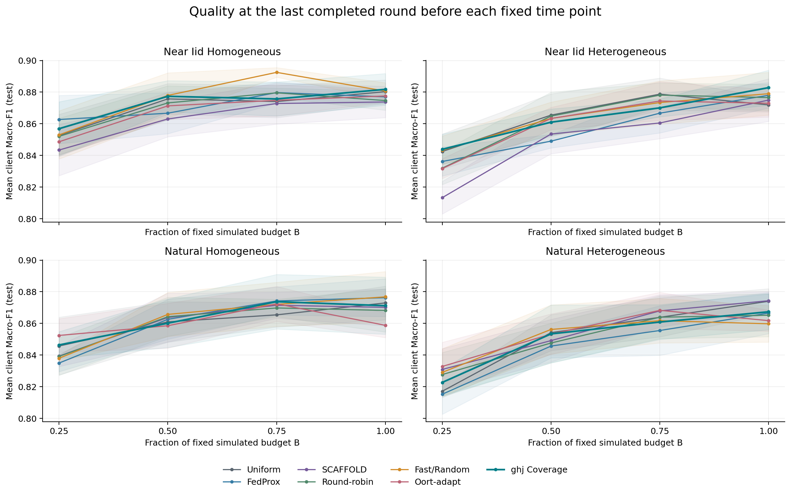
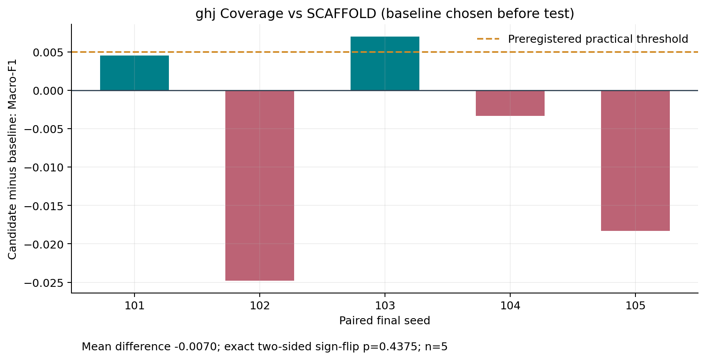
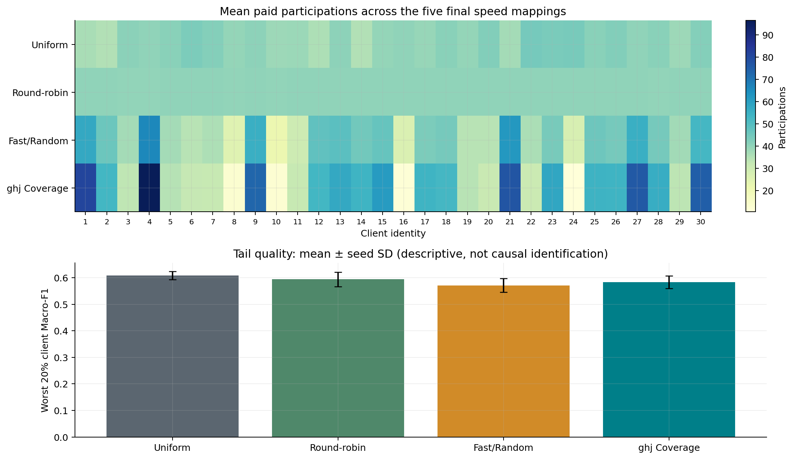
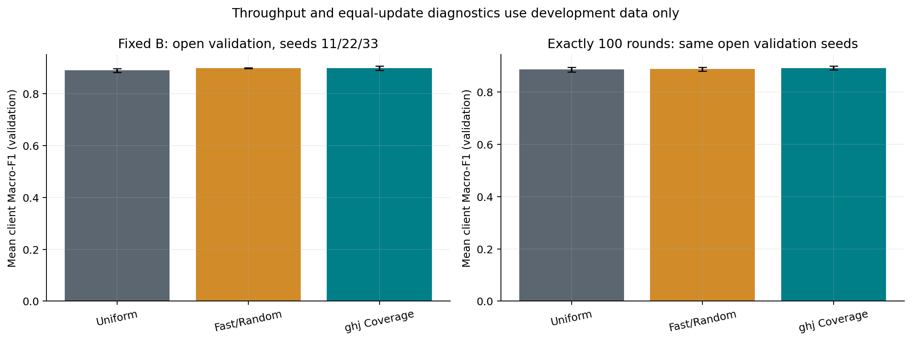
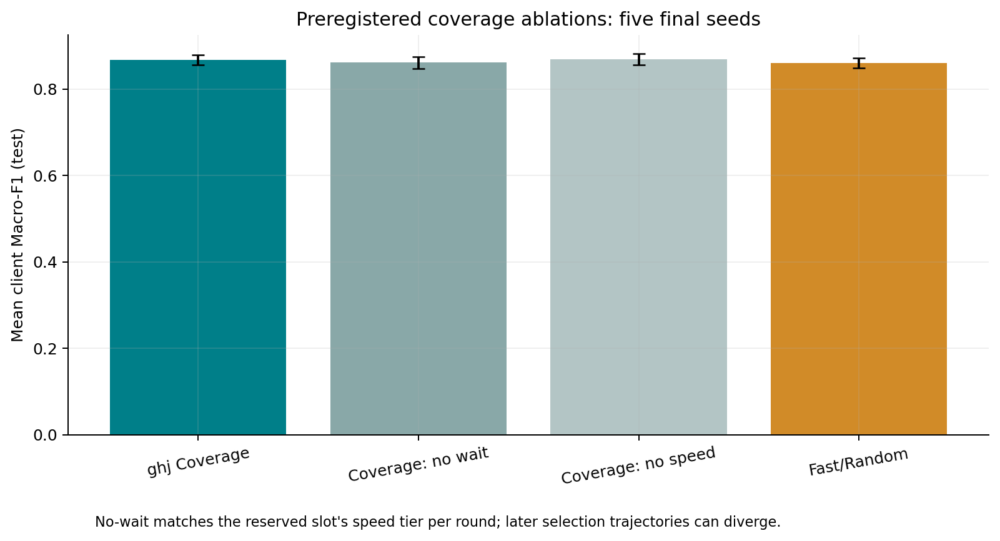
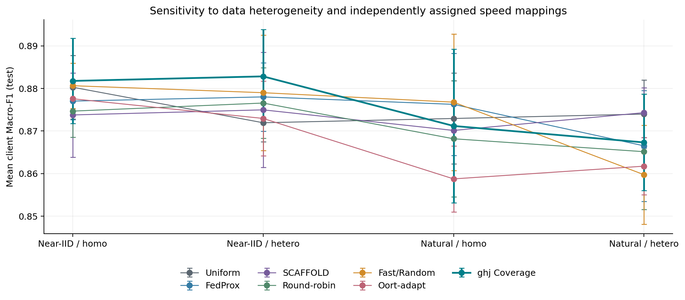

# 面向异构云边感知的联邦客户端选择：ghj 可复现实验报告

## 摘要

完成了 HAPT 的数据审计、完整强基线、预算校准、144 次全预算开发运行、9 次等轮数诊断、6 次受限确认，以及 175/175 次预注册正式运行。候选相对开放验证阶段预选的最强基线 SCAFFOLD，主条件测试 Macro-F1 均值降低 0.006987。未证实候选相对最强开发基线有达到预注册阈值的优势；该负结果同样保留。

## 1. Motivation：研究动机

云边端设备训练速度不同，按速度选择可提高同一时间内的更新数量，却可能减少慢用户的数据参与。研究问题是在完全相同模拟时间预算下，显式等待覆盖能否提高客户端等权平均质量。本研究是轻量 CPU 仿真，不声称实现真实工业网络或证明隐私安全。

## 2. Existing Gap：对照与研究边界

速度和代表性权衡已有大量研究，不能宣称首次提出。使用 Uniform、FedProx、SCAFFOLD、轮转、Fast/Random 和 Oort 适配版作为对照。Oort 保留 RMS 效用、探索/利用、成本惩罚和 pacer，但与原实现仍有探索与时间不确定度等差异，因此结论只适用于本适配及当前协议。

## 3. Observation：搜索前观察

先做 36 次完整 LR/轮数校准，所有数据来自开放验证。预注册选择共享 LR=0.1；B=9.836224400 模拟秒，约为异构 Uniform 200 轮；最小实际意义差异=0.005000。不选择预算内最好 checkpoint，统一评价最后一个完整轮次，故相邻轮质量可能有波动。

## 4. Hypothesis：可证伪假设

在 Fast/Random 上预留等待触发的慢/陈旧用户覆盖名额，可用部分吞吐换取更好的客户端代表性。预注册名额 {1,2}、等待阈值 {.05B,.1B,.2B}；若对强基线的配对均值改善未达到阈值，则不支持具有实际意义的收益。

## 5. Method：方法与公平性

30 个用户，每轮 6 人，先轮转预热 5 轮，每个选中客户端 4 个 SGD step，batch 16；模型 48→64→6，等客户端聚合。预热、完整序列化权重及控制变量消息、选择器与 SCAFFOLD 额外计算均按冻结系数计费。速度倍率 1/4/16，每档10人，映射独立于训练标签。候选配置为 agents/ghj/configs/candidates/coverage-1-0.2.json，按预注册近似持平规则优先较少覆盖名额和较大等待阈值，并非只挑最高点估计；开放验证后冻结，确认与测试均不再调参。训练 2748、验证1194、测试1462窗口，原始采样区间零交集、标准化仅拟合训练数据。

## 6. Evaluation：正式评测

7种联邦方法×4条件×5种子=140；两种解释性参考×两种数据条件×5=20；两项候选消融×5=10；经典样本量加权 FedAvg×5=5，合计175。正式种子101..105；每个测试用户固定六类 Macro-F1，30人等权平均。Local-only每人160step、Centralized4800step，只作曝光匹配参考，不比较同B优势。参考运行的FL消息计数和FL模拟时钟为0；数据集中上传量、参考系统端到端模拟耗时未测量，明确保留null，不能解释为集中训练免费。

| 方法 | 测试 Macro-F1 均值±SD | 最差20%用户 | 平均轮数 | 上/下行 MiB | 实际 Wall秒 |
| --- | --- | --- | --- | --- | --- |
| Uniform | 0.873985 ± 0.007973 | 0.608442 | 200.2 | 18.80 / 18.73 | 3.90 |
| FedProx | 0.866525 ± 0.012997 | 0.598633 | 171.0 | 16.06 / 16.00 | 5.70 |
| SCAFFOLD | 0.874314 ± 0.005881 | 0.611191 | 144.8 | 25.94 / 25.94 | 3.39 |
| Round-robin | 0.865154 ± 0.013559 | 0.593743 | 200.0 | 18.78 / 18.71 | 3.65 |
| Fast/Random | 0.859753 ± 0.011587 | 0.570765 | 210.6 | 19.78 / 19.70 | 4.85 |
| Oort-adapt | 0.861756 ± 0.006693 | 0.588805 | 202.6 | 19.03 / 18.95 | 4.01 |
| ghj Coverage | 0.867327 ± 0.011320 | 0.583252 | 237.4 | 22.30 / 22.21 | 5.86 |

| 种子 | 候选−预选最强基线 |
| --- | --- |
| 101 | +0.004507 |
| 102 | -0.024798 |
| 103 | +0.007003 |
| 104 | -0.003312 |
| 105 | -0.018333 |

四条件敏感性（同一预选对照）：

| 条件 | 候选均值 | SCAFFOLD均值 | 配对均值差 |
| --- | --- | --- | --- |
| 近IID / 同构 | 0.881758 | 0.873775 | +0.007983 |
| 近IID / 异构 | 0.882825 | 0.874971 | +0.007854 |
| 自然用户 / 同构 | 0.871195 | 0.870146 | +0.001049 |
| 自然用户 / 异构 | 0.867327 | 0.874314 | -0.006987 |

曝光匹配参考：

| 曝光匹配参考 | 数据划分 | 均值±SD |
| --- | --- | --- |
| Local-only | 近IID / 同构 | 0.788540 ± 0.012580 |
| Centralized | 近IID / 同构 | 0.886196 ± 0.006706 |
| Local-only | 自然用户 / 同构 | 0.842744 ± 0.011446 |
| Centralized | 自然用户 / 同构 | 0.876432 ± 0.013737 |

## 7. Analysis：机制、配对与负结果

主比较严格使用开发阶段预选的 SCAFFOLD，没有用测试集更换对照。配对均值 -0.006987，SD=0.014029，精确双侧符号翻转 p=0.4375。确认集平均配对差=-0.022186，未据此调整参数。六条基线的完整配对差见 results.json。

未证实候选相对最强开发基线有达到预注册阈值的优势；该负结果同样保留。

| 主条件配置 | 均值±SD |
| --- | --- |
| ghj Coverage | 0.867327 ± 0.011320 |
| Coverage: no wait | 0.861253 ± 0.013892 |
| Coverage: no speed | 0.868405 ± 0.013078 |
| Sample-weighted FedAvg | 0.874745 ± 0.006738 |

等100轮诊断只用开放验证、标为partial，共9次；用于区分吞吐与相同更新数的质量。参与次数、等待和尾部质量展示描述性关联，不把相关窗口或30个用户冒充更多独立种子。

| 开放验证诊断 | 完整B均值 | 100轮均值±SD | 100轮模拟秒 |
| --- | --- | --- | --- |
| Uniform | 0.889707 | 0.885913 ± 0.008700 | 4.881494 |
| Fast/Random | 0.898730 | 0.887860 ± 0.007380 | 4.681800 |
| ghj Coverage | 0.898593 | 0.891552 ± 0.007065 | 4.176087 |

## 8. Limitations：局限与适用边界

仅一个HAPT数据源、轻量统计特征和小MLP；窗口按记录拆分但仍来自同一数据集，30人均参与训练，因此不是未见用户泛化。每个正式种子同时改变初始化、minibatch和独立于标签的速度映射，种子SD包含多种随机来源。设备倍率、网络速率、RTT是模拟假设；实测CPU中位数是固定参考系数，不能等同真实异构网络的精确时延。Oort是有限适配；每类选择器只测代表配置的固定开销，成本细微变化仍可能影响末轮。覆盖名额的同速度档消融只匹配单轮档位，后续选择轨迹可能分离。五个正式种子最小双侧符号翻转p=.0625，不能宣称p<.05。峰值内存未测量，保留null；没有执行可选235次扩展或第二独立数据集。所有实验由ghj单工作区顺序完成，不冒称其他三位成员已参与；团队人工审阅、Champion晋级及GitHub管理需实际成员权限。

## 复现与证据

研究代码 commit：51b2cec2e529a2ceb2ba0ba8f8b4664a3ca5015b；正式矩阵预注册commit：7c13a2686b0d38ad170dd5415b9e394d144db5ad；协议SHA-256：aa3551b6b85b6074adcac1786f587a728a0d62fc3e041c4c4e6625b2d3be2fc0；数据SHA-256：f3382a029de9e2179f545bc5e8d2f1b87a2ea798dd06e2b473cf6bcc7f6d9702。全部372个已发布终态工件zip已核验SHA-256。源代码、冻结配置、原始测量、逐轮日志和检查点均随交付提供。

`uv sync --locked`

`uv run --locked --exact python scripts/research.py campaign configs/final/core-final-v2.json`

该命令检查/恢复原活动，已有终态会跳过。要实际重新训练175行并保留原证据，执行 `uv run --locked --exact python scripts/replay_campaign.py --replicate-id core-final-replay-v1`。复现沿用原种子，不增加独立样本量。完整交付包包含Git历史、处理后缓存、逐轮工件和恢复脚本；从Git单独检出则需先准备数据和取回工件。详见 docs/ghj-execution.md。开发排行榜由同步脚本生成，Champion未自动晋级。

## 参考资料

[1] McMahan et al., Communication-Efficient Learning of Deep Networks from Decentralized Data, AISTATS 2017. https://proceedings.mlr.press/v54/mcmahan17a.html [2] Li et al., Federated Optimization in Heterogeneous Networks, MLSys 2020. [3] Karimireddy et al., SCAFFOLD: Stochastic Controlled Averaging for Federated Learning, ICML 2020. https://proceedings.mlr.press/v119/karimireddy20a.html [4] Lai et al., Oort, OSDI 2021. https://www.usenix.org/conference/osdi21/presentation/lai [5] UCI HAPT dataset #341. https://archive.ics.uci.edu/dataset/341/ . Oort永久源代码链接与逐项偏离说明见docs/oort-adaptation.md。

## 图表

